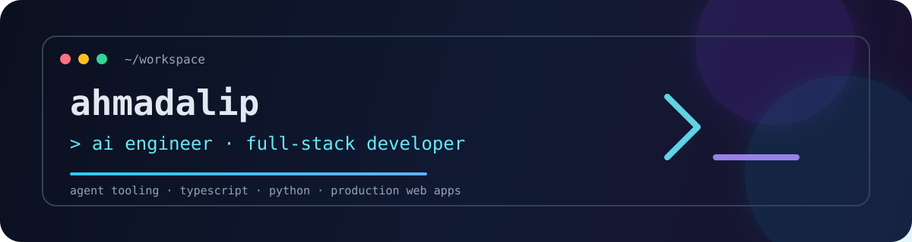

  

  
  
  

## Hello, I’m ahmadalip

I build **terminal-first AI tools for developers** — practical systems that make coding workflows safer, clearer, and more productive.

My work sits at the intersection of **AI agents, command-line interfaces, and developer experience**. I care about useful automation, visible actions, and keeping people in control of what their tools can do.

> Build useful tools. Keep humans in control.

## What I’m building

| Project | Purpose | Stack |
| --- | --- | --- |
| [iooi CLI](https://github.com/ahmadalip/iooi-Cli) | A safety-first AI coding assistant with provider support, permission modes, sessions, file tools, and Git workflows. | TypeScript · Node.js |
| [AI Coding Agent](https://github.com/ahmadalip/ai-coding-agent) | A terminal-based AI pair programmer with interactive chat, agentic tool use, context awareness, and safe project editing. | Python · LLM APIs |
| [OpenCode fork](https://github.com/ahmadalip/opencode) | An open-source codebase I am exploring to learn more about terminal-first AI coding systems. | Go |

## Current direction

- Designing **safe and transparent AI agent workflows** for real development projects.
- Improving terminal interfaces so users can understand what an assistant is doing.
- Learning by shipping focused projects in **Python, TypeScript, Go, and Node.js**.

## Toolbox

`Python` `TypeScript` `JavaScript` `Go` `Node.js` `Git` `CLI tooling` `LLM integrations`

## A little more

I’m interested in open-source work around AI developer tools, terminal interfaces, automation, and thoughtful developer experience. If you are building in this space, explore the repositories above or open an issue on a project.

  <a href="https://github.com/ahmadalip?tab=repositories">Explore the work</a>
  ·
  <a href="https://github.com/ahmadalip/iooi-Cli/issues">Discuss an idea</a>

